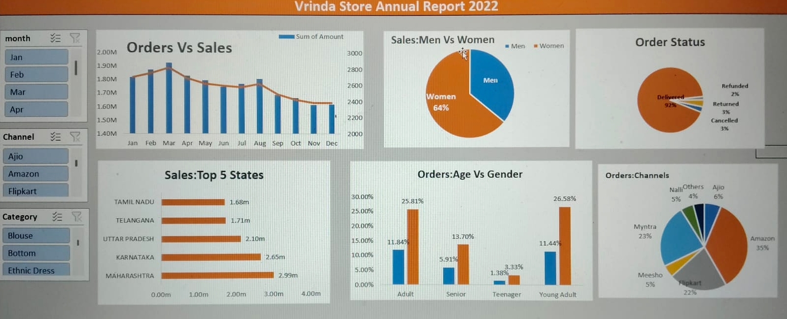

# Vrinda Store - Sales Data Analysis | Excel Dashboard 2022

## 📊 Project Overview
This project analyzes the annual sales data of Vrinda Store for the year 2022.
The goal is to understand sales trends, customer behavior, and order performance using Excel Pivot Tables, Charts, and an Interactive Dashboard.

## 🎯 Business Problem
Vrinda Store wanted to know:
- Which months had highest sales?
- Who buys more - Men or Women?
- Which states are giving highest sales?
- Which sales channel is best?
- What is the order status?

## 🛠️ Tools Used
- Microsoft Excel
- Pivot Tables
- Pivot Charts
- Slicers
- Data Cleaning

## 📁 Files in this Project
- `Vrinda Store Data Analysis.xlsx` - Complete Data + Pivot Tables + Dashboard
- `Dashboard-Screenshot.png` - Dashboard Preview

## 📈 Dashboard Preview

## 🔍 Key Insights

### 1. Orders Vs Sales
- Highest sales in March - 1.92M
- Sales were stable from Jan to Aug, then slightly decreased.

### 2. Sales: Men Vs Women
- Women - 64% of total sales
- Men - 36% of total sales
- Women are the main customers of Vrinda Store.

### 3. Order Status
- Delivered - 92%
- Cancelled - 3%
- Returned - 3%
- Refunded - 2%
- 92% delivery rate shows very good performance.

### 4. Sales: Top 5 States
- Maharashtra - 2.99M - No.1
- Karnataka - 2.65M
- Uttar Pradesh - 2.10M
- Telangana - 1.71M
- Tamil Nadu - 1.68M

### 5. Orders: Age Vs Gender
- Young Adult Women - 26.58% - Highest
- Adult Women - 25.81%
- Young Adult and Adult Women are the top buyers.

### 6. Orders: Channels
- Amazon - 35% - Top Channel
- Flipkart - 22%
- Myntra - 23%
- Ajio - 6%
- Meesho - 5%
- Others - 4%
- Nalli - 5%
- Amazon is the best performing channel.

## 💡 Final Conclusion
- Vrinda Store should focus more on Women customers, especially Young Adult & Adult age group.
- Focus on Maharashtra, Karnataka & Uttar Pradesh for more growth.
- Amazon, Flipkart & Myntra are the best channels to invest in.
- Maintain 92% delivery success rate.

## 👩‍💻 Created By
Pooja - Data Analyst Aspirant
